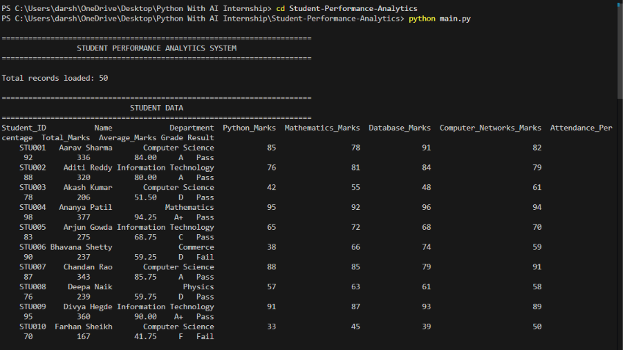
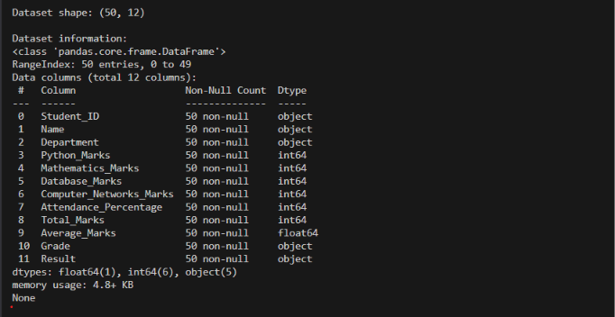
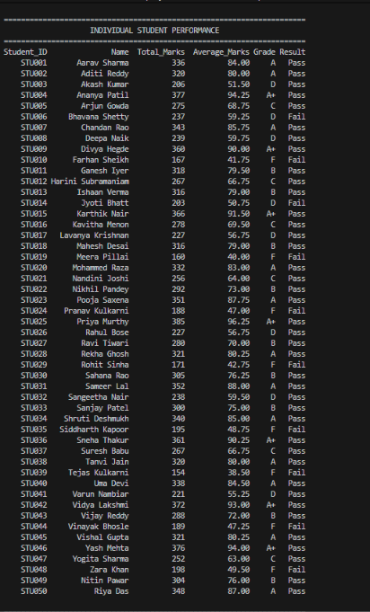
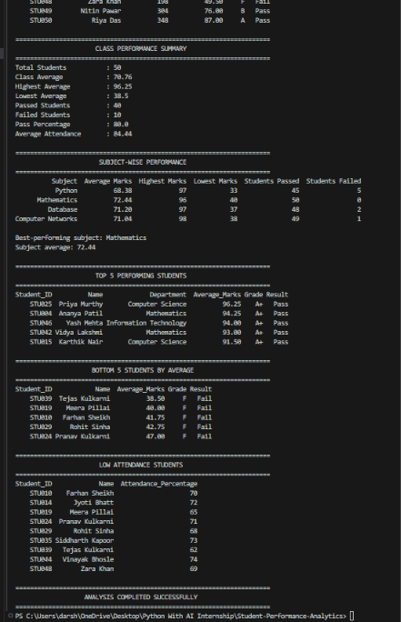

# STUDENT PERFORMANCE ANALYTICS SYSTEM

## Project Documentation

**Student Name:** Darshan K M  
**Institution:** CMR University, Bengaluru  
**Programme:** Master of Computer Applications (MCA)  
**Course:** Python with AI  
**Project Title:** Student Performance Analytics System  
**Technologies Used:** Python, NumPy, Pandas  
**Dataset File:** students.csv  
**GitHub Repository:** https://github.com/Darshan-yadav-45/Python-With-AI-Internship  

---

## 1. Project Title

**Student Performance Analytics System**

Developed as the final project for the EWB Courses – Python with AI Internship.

---

## 2. Objective

The objective of this project is to develop a Python-based Student Performance
Analytics System that processes and analyzes student academic data stored in a
CSV file.

**Problem Statement:**  
Managing and evaluating the academic performance of a large group of students
manually is time-consuming and error-prone. An automated system is needed to
compute marks, assign grades, determine results, and generate a summary of
class performance.

**What the Project Solves:**

- Automatically loads 50 student records from a CSV dataset.
- Calculates total marks and average marks for every student.
- Assigns grades and determines pass or fail status based on defined criteria.
- Summarises class performance and identifies top and low performers.
- Performs subject-wise analysis and identifies the best-performing subject.
- Lists students with insufficient attendance.

This project demonstrates the practical application of Python programming
fundamentals, NumPy numerical computing, and Pandas data analysis.

---

## 3. Technologies Used

### 3.1 Python

Python is used to implement the entire program logic. It provides variables,
data types, conditional statements, loops, and reusable functions used
throughout the project.

### 3.2 NumPy

NumPy is used for numerical computations. Specifically:

- `np.mean()` – calculates student average marks from a NumPy array.
- `np.round()` – rounds averages to two decimal places.
- `np.where()` – determines pass/fail results using a conditional array operation.
- `np.max()`, `np.min()` – find highest and lowest subject marks.

### 3.3 Pandas

Pandas is used to:

- Read the CSV dataset into a DataFrame using `pd.read_csv()`.
- Validate columns, data types, and missing values.
- Calculate total marks using `DataFrame.sum(axis=1)`.
- Filter low-attendance records using boolean indexing.
- Sort and rank students using `nlargest()` and `nsmallest()`.
- Build the subject-wise analysis table as a new DataFrame.

### 3.4 CSV

The student dataset is stored in `students.csv`. This flat-file format is
simple, human-readable, and easily loaded using Pandas.

---

## 4. Dataset Description

The dataset is stored in `students.csv` and contains **exactly 50 student
records**.

### Column Structure

| Column Name | Data Type | Description |
|---|---|---|
| Student_ID | String | Unique ID (STU001 – STU050) |
| Name | String | Student full name |
| Department | String | Academic department |
| Python_Marks | Integer | Marks in Python (0 – 100) |
| Mathematics_Marks | Integer | Marks in Mathematics (0 – 100) |
| Database_Marks | Integer | Marks in Database (0 – 100) |
| Computer_Networks_Marks | Integer | Marks in Computer Networks (0 – 100) |
| Attendance_Percentage | Integer | Attendance percentage (0 – 100) |

### Dataset Validation (Verified by Running the Program)

| Check | Result |
|---|---|
| Total records | 50 |
| Missing values | None |
| Duplicate Student_IDs | None |
| Marks range (0–100) | All valid |
| Attendance range (0–100) | All valid |

### Departments Represented

- Computer Science
- Information Technology
- Mathematics
- Physics
- Commerce

---

## 5. Implementation

### 5.1 Project File Structure

```
Student-Performance-Analytics/
├── main.py                   – Main program
├── functions.py              – Reusable functions
├── students.csv              – 50-record dataset
├── README.md                 – Project overview
└── Project_Documentation.md – This documentation
```

### 5.2 Load the Dataset (`functions.py` → `load_student_data()`)

The `load_student_data()` function uses `pd.read_csv()` to load the CSV file
into a Pandas DataFrame. It validates:

- All required columns are present.
- No missing values exist.
- All marks are numeric and within 0–100.
- Attendance is numeric and within 0–100.

```python
df = pd.read_csv(file_path)
```

### 5.3 Calculate Total Marks (`calculate_total_marks()`)

Pandas `DataFrame.sum(axis=1)` adds the four subject marks row-wise for every
student.

```python
df["Total_Marks"] = df[SUBJECTS].sum(axis=1)
```

**Formula:** Total Marks = Python + Mathematics + Database + Computer Networks

### 5.4 Calculate Average Marks (`calculate_average_marks()`)

The marks columns are converted to a NumPy array. `np.mean()` calculates the
row-wise mean, and `np.round()` rounds to two decimal places.

```python
marks_array = df[SUBJECTS].to_numpy(dtype=float)
df["Average_Marks"] = np.round(np.mean(marks_array, axis=1), 2)
```

**Formula:** Average Marks = Total Marks / 4

### 5.5 Assign Grades (`assign_grade()`, `assign_grades()`)

A Python function uses `if-elif-else` conditional statements to assign a grade
based on the student's average marks.

```python
def assign_grade(average):
    if average >= 90:
        return "A+"
    elif average >= 80:
        return "A"
    elif average >= 70:
        return "B"
    elif average >= 60:
        return "C"
    elif average >= 50:
        return "D"
    else:
        return "F"
```

The `assign_grades()` function applies this to all students using
`DataFrame.apply()`.

### 5.6 Determine Pass or Fail (`assign_pass_fail()`)

Pass criteria:

- **Minimum 40 marks** in every subject.
- **Minimum 75% attendance**.

A student must satisfy **both** conditions to pass.

```python
subject_pass = (df[SUBJECTS] >= PASS_MARKS).all(axis=1)
attendance_pass = (df["Attendance_Percentage"] >= MIN_ATTENDANCE)
df["Result"] = np.where(subject_pass & attendance_pass, "Pass", "Fail")
```

`np.where()` is used for vectorised conditional assignment.

### 5.7 Class Performance Summary (`get_class_summary()`)

This function collects overall class statistics using Pandas aggregation:

- Total students, class average, highest/lowest average.
- Count of passed and failed students.
- Pass percentage and average attendance.

### 5.8 Subject-Wise Analysis (`get_subject_analysis()`)

A `for` loop iterates over each subject column. Each subject's marks array is
converted to NumPy, and `np.mean()`, `np.max()`, `np.min()` compute
statistics. The results are assembled into a new Pandas DataFrame.

### 5.9 Top and Bottom Performers (`get_top_performers()`)

`DataFrame.nlargest()` returns the top N students ranked by average marks.
`DataFrame.nsmallest()` returns the bottom N students. Both are used in
`main.py`.

### 5.10 Low Attendance Students (`get_low_attendance_students()`)

Boolean indexing filters the DataFrame for students with
`Attendance_Percentage < 75`.

### 5.11 Main Program (`main.py`)

The `main()` function orchestrates all steps:

1. Calls `load_student_data()` to load and validate the dataset.
2. Calls `process_student_data()` to run all calculations.
3. Calls each display function in sequence.
4. Wraps everything in `try-except` for error handling.

---

## 6. Key Features

1. Reads student data from a CSV file using Pandas.
2. Validates all required columns and data ranges on load.
3. Calculates total marks using Pandas row-wise sum.
4. Calculates average marks using NumPy array operations.
5. Assigns grades using Python conditional statements.
6. Determines pass/fail results using NumPy `np.where()`.
7. Displays full dataset with calculated columns.
8. Generates a class performance summary with 8 statistics.
9. Performs subject-wise analysis across 4 subjects using a loop.
10. Identifies the best-performing subject automatically.
11. Displays the top 5 performing students.
12. Displays the bottom 5 students by average marks.
13. Lists all students with attendance below 75%.
14. All logic is separated into reusable functions in `functions.py`.

---

## 7. Output / Screenshots

The program was successfully tested and produced the following actual output.

### 7.1 Program Header & Dataset Preview
Below is the execution output when running `python main.py`, showing the system header, 50 records loaded, and the dataset preview:



### 7.2 Dataset Shape & Structure Information
Detailed Pandas DataFrame structure, showing all 50 non-null records across 12 calculated columns:



### 7.3 Individual Student Performance
The calculated individual metrics including Total Marks, Average Marks, Grade, and Result for each student:



### 7.4 Class Summary, Subject Analysis, Top Performers & Attendance
Complete class performance analytics, subject-wise statistics, best-performing subject, top 5 and bottom 5 students, and low attendance alert:



---

## 8. Final Outcome

The Student Performance Analytics System was **successfully completed and
tested**. All 50 student records were processed without errors.

**Verified Outcomes:**

- All 50 records loaded and validated correctly (no missing values or duplicates).
- Total marks and average marks calculated correctly for all students.
- Grades assigned correctly using the defined grading scale.
- Pass/fail determined correctly using the marks and attendance criteria.
- 40 students passed and 10 students failed out of 50.
- Class average is 70.76 with a pass percentage of 80%.
- Mathematics was identified as the best-performing subject (average: 72.44).
- Top 5 students correctly identified, led by Priya Murthy (96.25 average).
- 9 students identified as having attendance below 75%.
- Program runs successfully using only Python, NumPy, and Pandas.
- `main.py` exits with code 0 (no errors).

---

## 9. Challenges and Learning Outcomes

### 9.1 Challenges

| Challenge | Solution Applied |
|---|---|
| Loading and validating CSV data correctly | Used Pandas `read_csv()` with column checks and type validation |
| Handling missing or invalid data | Added explicit null checks and numeric range validation in `load_student_data()` |
| Implementing pass/fail with two separate conditions | Used `np.where()` with combined boolean masks for marks and attendance |
| Applying grading conditions accurately | Used nested `if-elif-else` in a dedicated `assign_grade()` function |
| Separating concerns for readability | Split all logic into named functions in `functions.py`, keeping `main.py` clean |
| Keeping the dataset realistic and varied | Manually designed 50 records with varied departments, marks, and attendance |

### 9.2 Learning Outcomes

Through this project, practical experience was gained in:

- Python variables, data types, conditional statements, and loops.
- Writing and using reusable functions with clear responsibilities.
- Reading and validating CSV files using Pandas.
- Creating and manipulating Pandas DataFrames.
- Performing numerical computations using NumPy arrays.
- Filtering, sorting, and summarising datasets.
- Analysing student performance from structured data.
- Organising a Python project with multiple source files.
- Maintaining and submitting a project through GitHub.

---

## 10. GitHub Repository

**Repository Name:** Python-With-AI-Internship  
**Repository URL:** https://github.com/Darshan-yadav-45/Python-With-AI-Internship

The repository contains:

- `main.py` – Main program
- `functions.py` – Reusable analysis functions
- `students.csv` – 50-record student dataset
- `README.md` – Project overview and instructions
- `Project_Documentation.md` – This documentation file

> **Action Required:** Push all updated files to the repository using the
> Git commands provided at the end of this document.

---

## Conclusion

The Student Performance Analytics System demonstrates the practical
application of Python programming fundamentals, NumPy, and Pandas to
real-world student data analysis. The project successfully processes
50 student records, computes performance metrics, and presents readable
analytical output — fulfilling all internship assessment requirements.

---

**Submitted by:** Darshan K M  
**Institution:** CMR University, Bengaluru  
**Programme:** Master of Computer Applications (MCA)  
**Course:** Python with AI  
**Email:** darshan.km.091@gmail.com
